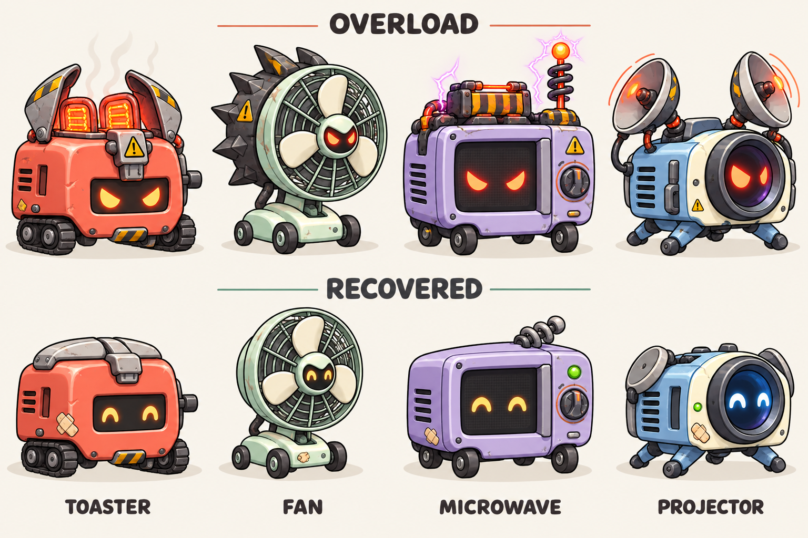

# 가전 보스와 상위 조합 로봇 — 공통 기체 설계

**이후 6속성·단계 확장 요청 반영:** 최신 제품 원형은 [속성별 4단계 + 공통 S 성장표](SIX_ELEMENT_ROSTER.md)를 따른다. 현재 구역1/3/4/5의 새 보스 대응은 가스레인지/산업용 송풍기/고압변압기/레이저 절단기를 유지한다. 새 4단계는 후반 보스의 공통 원형 후보이며 초반 보스를 일괄 승격하지 않는다. 아래 토스터·전자레인지·프로젝터 등은 이전 시안 기록이며 실행 자산으로 채택한 상태가 아니다. 공통 부품 참조·적/아군 구별·용량 측정 원칙은 유지한다.

2026-09-27. 사용자 요청에 따라 보스의 가전·전자제품 디자인과 상위 조합 로봇의 자산 공유를 설계했다. 대장이 아트 시안을 제작하고 기획·밸런스팀과 클라이언트팀이 현행 콘텐츠·파일을 검토했다. **이번 산출물은 콘셉트와 제작 설계다. 실행 중인 보스 그림·판정·조합식을 교체한 패치가 아니다.**

## 선택한 방향

같은 기체의 **폭주형 보스 → 복구형 아군**을 만든다. 익숙한 가전제품 자체가 몸이고, 얼굴·바퀴·핵심 장치가 붙는다. 사람이 가전을 들고 있는 형태는 사용하지 않는다. 초반 보스에서 본 특징을 이후 상위 조합에서 다시 알아보게 한다.

공유의 단위는 완성 그림을 복사한 파일이 아니라 **하나의 몸체·부품·동작 참조**다. 보스와 아군의 체력·공격·이동·보상 데이터는 독립적으로 둔다. 상위 아군의 능력치를 그대로 보스에게 적용하거나, 보스 처치가 즉시 아군 지급이라는 규칙을 추가하지 않는다.

| 접근 | 장점 | 비용·판단 |
| --- | --- | --- |
| 아군 완성 그림을 크게 확대 | 제작량이 적음 | 적/아군 혼동, 확대 흐림, 보스 개성 부족. 최종 방향으로 채택하지 않음 |
| 공통 기체 + 보스 전용 부착물·표정·연출 | 가족을 알아보면서 구별 가능, 실제 이미지 참조 공유 가능 | 부품 연결·피벗·상태별 합성 필요. **권장안** |
| 보스 전체를 별도 제작 | 자유로운 실루엣과 동작 | 제작·수정·출력량이 늘어남. 후반 핵심 보스의 고유 부품에 제한적으로 사용 |

## 시안

상단은 폭주형, 하단은 복구형이다. 기본 실루엣과 장치를 맞추고 보스에 과부하 부품을 얹었다. 이미지 생성 후 배경·글자 대비를 개선했다. **시안의 두 몸체가 실제로 같은 픽셀·부품을 참조한다는 증거는 아니다.** 제작 시 한 원본으로 분해·정리해야 한다. 시안은 애니메이션 시트도, 투명 게임 스프라이트도 아니다.

## 현행 5구역에 대한 디자인 대응

현재 실행 기준은 `0.12.0-field-mods`, 5구역·29유닛·20조합이다. 아래 기존 이름/ID는 연결 대상이며 이름·재료·속성을 이번에 변경하지 않는다.

이후 사용자 명칭 피드백을 반영한 [한국어 이름 검토](../reviews/2026-09-27-korean-robot-names.md)의 우선 후보는 **불꽃 토스터 / 회오리 선풍기 / 번개 전자레인지 / 광선 영사기**다. 아래 표는 현재 데이터와의 대응을 위해 현행 이름을 보존하며, 새 이름은 가전 원형과 함께 적용할 제안이다.

| 현재 구역 | 보스 이름 / 가전 | 공유할 상위 조합 로봇 | 공통으로 보존할 특징 | 보스 전용 식별 |
| --- | --- | --- | --- | --- |
| 1 착륙 지대 | **폭주 토스터** | 볼트타이탄 `zhang_fei` · 화염 | 둥근 적갈색 상자, 두 가열 슬롯, 작은 궤도 | 벌어진 열 차폐판, 삼각 고장 표식, 과열된 슬롯 |
| 2 채굴장 | **보스 없음** | 해당 없음 | 기존 4분 시설 방어 | 보스 추가로 시간을 늘리지 않음 |
| 3 엔진 기지 | **과열 강풍기** | 궤도브레이커 `xiahou_dun` · 바람 | 큰 원형 팬, 세 날개, 낮은 이동 받침 | 탈착 가능한 비대칭 터보 덮개, 흔들리는 그릴 |
| 4 좁은 협곡 | **방전 전자레인지** | 플라즈마캐스터 `zhou_yu` · 전격 | 사각 유리문, 우측 다이얼, 낮은 바퀴 | 외부 축전기와 들린 방전 안테나, 문틀 경고 부품 |
| 5 탈출항 | **폭주 빔프로젝터** | 오비탈옵저버 `sima_yi` · 레이저 | 큰 전면 렌즈, 냉각핀, 낮은 삼각 받침 | 펼친 보조 반사판, 렌즈 보호턱, 과부하 표시 |

초기 제작 우선순위는 토스터 한 계열이다. 선풍기·프로젝터가 다음이고, 전자레인지는 현행 4구역을 구분할 추가 계열이다. 현재 모바일 대표 세트의 `zhang_fei`는 토치 가족 외형이므로 토스터가 기존에 완성된 자산이라고 간주하지 않는다. 나머지 세 상위 유닛도 현재 대표 PNG 세트에 없다. **이는 기존 고품질 그림을 단순 연결하는 작업이 아니라, 앞으로 같은 기체를 한 번 제작해 양쪽에서 쓰는 계획이다.**

## 성장과 세계관 연결

설정은 버려진 가전의 제어 장치가 고장 나 폭주하고, 원정대가 회수한 구조를 안전한 출력으로 복구·조립하는 것이다. 보스의 파괴 후 경고등이 꺼지고 가열판·팬·렌즈가 드러나는 짧은 연출로 공통 원형을 보여준다. 반짝이는 보상 상자나 새 재화를 추가할 필요는 없다.

첫 토스터의 아군 연결인 `make_zhang_fei`는 현재 2구역 클리어로 조합식이 열린다. 강풍기 `make_xiahou_dun`도 2구역, 전자레인지 `make_zhou_yu`와 프로젝터 `make_sima_yi`는 3구역 클리어 해금이다. 보스 처치 즉시 새 레시피 지급이라고 안내하지 않는다. 현재 영웅 직접 소환 가능성이 있어 반드시 보스를 먼저 보고 아군을 얻는 순서도 보장하지 않는다.

전투 종료 후 관련 설계도를 안내한다면 실제 계정 해금 상태를 읽고, 사용할 수 있는 경우에만 조합 경로로 연결한다. 이 안내 UI와 회수 연출은 후속 구현 항목이다.

## 미래 8구역안과 구분

[챕터 1 제안](CHAPTER_ONE_PROPOSAL.md)의 보스 배치는 1-1/1-5/1-8이다. 그 안에서는 토스터/강풍기/프로젝터를 각각 배치하고 전자레인지는 예비로 둔다. 1-2/1-3/1-4/1-6/1-7에 보스를 억지로 추가하지 않는다.

5종 기본 풀·18유닛·13조합·8맵 전환은 첫 실기기 관문 뒤의 별도 작업이다. 위 현행 ID를 미래 18종의 확정 ID나 조합식으로 간주하지 않는다. 현재 구역 번호를 그대로 이동해 기존 클리어 기록을 덮어쓰지도 않는다.

## 동작과 플레이 가독성

공통 몸체의 움직임 위에 보스 장갑·표정만 합성한다. 색 외에 크기·열린 외장·삼각 경고 부품·보스 체력 표시로 구별한다. 복구형은 정돈된 부품과 수리 패치를 갖는다. 시안에 있는 작은 볼트·그릴 선은 실제 표시 크기에서 지저분하면 줄인다.

| 기체 | 등장·이동의 특징 | 실제 판정 전에는 넣지 않을 표현 |
| --- | --- | --- |
| 토스터 | 가열 슬롯이 켜짐 → 차폐판이 들림 → 작은 궤도 이동 | 피해 판정 없는 불 장판, 냉동만 정답으로 보이는 약점 표시 |
| 강풍기 | 팬이 느리게 돌다 회전 증가, 받침이 짧게 흔들림 | 실제로 끌어당기거나 밀지 않는 바닥 흡입·밀치기 예고 |
| 전자레인지 | 유리문 안쪽 점등, 축전기 작은 방전, 바퀴 이동 | 아군 정지·EMP가 구현되지 않았는데 기절을 나타내는 연출 |
| 프로젝터 | 렌즈 조리개가 열림, 반사판이 펼쳐짐, 낮은 받침 이동 | 실제 피해 없는 화면 횡단 레이저·전장 전체 경고선 |

현재 코어는 공통 `boss` 판정이며 보스별 속성·고유기가 없다. 위 차이는 먼저 **외형·등장·이동 표현**으로 설계한다. 피격·파괴는 실제 서버 HP와 종료에 연결하고, 보스의 새 공격 패턴은 예고 시간·회피 또는 대응 수단·서버 판정·난도 검증을 함께 설계할 때 추가한다. 아군의 사거리·범위·연쇄 공격 표현도 실제 현재 속성을 따라야 한다.

움직임 줄이기에서는 팬·진동·깜박임을 줄여도 열린 장갑과 표정이 남는다. 보스를 크게 그리는 비율은 우선 아군 대비 약 1.4~1.6배 후보로 비교하며 실제 화면 점유·선택 방해 검사 뒤 확정한다. 1구역 최대 3분/난도 1, 2구역 4분/난도 1.5를 유지한다.

## 실제 자산 측정과 공유 계약

클라이언트팀이 현재 `client/Assets/Resources/MobileArt`의 파일 바이트·PNG IHDR·SHA-256을 읽었다. [원시 측정 기록](../reference/2026-09-27-boss-resource-audit.json)을 보관했다. 아래는 **해당 폴더의 PNG 원본 수치**이며 IPA/압축 텍스처/GPU 메모리 측정값이 아니다. 별도 콘셉트 보드는 이 게임 리소스 목록에 포함하지 않는다.

| 대상 | 현재 측정 |
| --- | ---: |
| 전체 PNG | 206개 / 2,675,163바이트 (2.55MiB) |
| 보스 PNG | 16개, 모두 512×512 / 486,689바이트 (475.3KiB) |
| 전체 고유 SHA-256 | 155개 |
| 같은 바이트인 추가 복사 | 51개 / 663,700바이트 (648.1KiB, 원본 PNG의 24.81%) |
| 보스 내부 추가 복사 | 5개 / 149,573바이트 (전체 중복 수치에 포함) |

초상화 7개도 각각 해당 유닛 `idle_00`과 동일하다. 먼저 프레임/초상 별칭으로 **206개 논리 참조 → 155개 고유 이미지**를 연결하는 실험이 가능하다. 이는 제거 가능한 원본 중복의 상한이며 실제 빌드 절감률이 아니다. 프레임명뿐 아니라 해시·피벗·임포트 설정의 동등성을 검증하고 로더 계약을 갱신해야 한다. 이번에는 파일을 삭제하거나 로더를 바꾸지 않았다.

현 exporter는 경로마다 PNG·GUID를 만들며, 공성 적/보스가 SVG 제작 코드를 공유해도 출력 파일은 별개다. 웹은 별도 SVG와 래스터 캐시를 사용하므로 모바일 PNG 공유만으로 웹의 메모리가 줄지는 않는다.

권장 제작 계약은 다음과 같다.

- `familyId`로 공통 몸체·바퀴·팬/렌즈·피벗·연결점을 정의한다. 보스/아군이 **같은 이미지 경로 또는 같은 Sprite 자산**을 가리킨다.
- `variant`는 보스/아군 부착물, 눈 표정, 표시 배율, 클립 매핑만 지정한다. 보스의 외장 때문에 공통 본체를 매 프레임 복제하지 않는다.
- 처음부터 무거운 범용 리깅 시스템을 만들지 않는다. 토스터 한 계열의 고정 연결점과 소수 파츠로 실제 화면을 비교한다. 공유하지 않는 파괴 조각 등은 별도 자산으로 둔다.
- 크기를 정규화해 공유하되 보스와 아군을 모두 512px로 무조건 올리지 않는다. 256px의 보스 확대 가독성과 공통 512px 사용 비용을 실제 화면/기기에서 비교한다.
- 참고 계산: RGBA8로 보스512² 16장 + 아군256² 16장은 20MiB의 픽셀량이다. 512² 16장 한 벌 공유는 16MiB + 추가 부착물이다. 이 수치는 압축·아틀라스·미프맵·CPU 복사 등을 제외한 계산이며 메모리 성능 보장이 아니다.
- 아틀라스는 묶어 그리기와 텍스처 구성 도구로 검토한다. UGUI에 맞는 회전/Read-Write/압축 설정을 점검하고, 아틀라스화 자체를 중복 제거 또는 용량 절감으로 간주하지 않는다. [Unity 공식 아틀라스 레퍼런스](https://docs.unity3d.com/kr/current/Manual/sprite/atlas/sprite-atlas-reference.html)
- 현재 네이티브의 경로별 Sprite 캐시는 관전 전환에도 유지된다. 화면에서 사라진 것과 자산이 해제된 것은 다르며 참조의 수명도 확인한다. [Unity UnloadUnusedAssets](https://docs.unity3d.com/6000.0/Documentation/ScriptReference/Resources.UnloadUnusedAssets.html)

## 제작·적용 순서와 완료 조건

1. **완료: 디자인 대응·시안·현황 측정.** 4쌍의 정지 콘셉트를 제작하고 기존 ID/속성/해금과 대응시켰다. 시안·출처·측정값을 보관한다.
2. **후속: 토스터 한 계열 제작.** 공통 파츠와 폭주 부착물, 피벗 고정, 적/아군 상태 클립을 제작한다. 실제 표시 크기에서 식별성을 비교한다. 시안 PNG를 잘라 바로 배포하는 것으로 대체하지 않는다.
3. **후속: 로더와 별칭.** 같은 자산 인스턴스를 참조하는지 검증한 뒤 중복 PNG를 정리한다. 기존 상태 프레임·초상·아이콘·재접속/관전·연출 축소가 모두 정상이어야 한다.
4. **후속: 표현 적용.** 구역별 보스 ID/이름을 공개 상태·HUD·웹·네이티브에 일관되게 연결한다. 현행 2구역의 무보스 종료와 초반 시간을 유지한다. 보스 교체가 소환·조합 RNG나 보상에 영향을 주지 않아야 한다.
5. **후속: 실기기 비교 후 확장.** 보스와 같은 계열 아군 동시 등장, 원정 입장→보스→귀환에서 빌드 크기·고유 텍스처 수·메모리 최고치·프레임 시간·식별 오류를 기록한다. 첫 iPhone 관문 후 나머지 계열로 확대한다.

## 출처와 현재 한계

시안은 사용자 아이디어와 자체 텍스트 지시를 기반으로 내장 이미지 생성 도구에서 새로 생성하고, 같은 도구로 배경·라벨 대비를 수정했다. 실제 제품 사진·로고·상업 게임 자산은 입력하지 않았다. 생성 이미지를 CC0 또는 저작권 검토 완료라고 표시하지 않는다. [제작 기록](../../assets/concepts/appliance-bosses-2026-09-27/PROVENANCE.md)과 [자산 대장](../../assets/manifest.json)에 보관했다.

이번 기술 검토의 외부 출처는 위 Unity 공식 문서이며, 아트의 외부 이미지 참조는 없다. 4쌍의 정지 콘셉트를 제작했지만 분리 파츠·애니메이션·실제 공유 로더는 아직 제작하지 않았다. 게임 실행 파일과 밸런스는 이 설계 작업에서 바꾸지 않았으며 실제 기기·인간 반응 검증도 수행하지 않았다.
